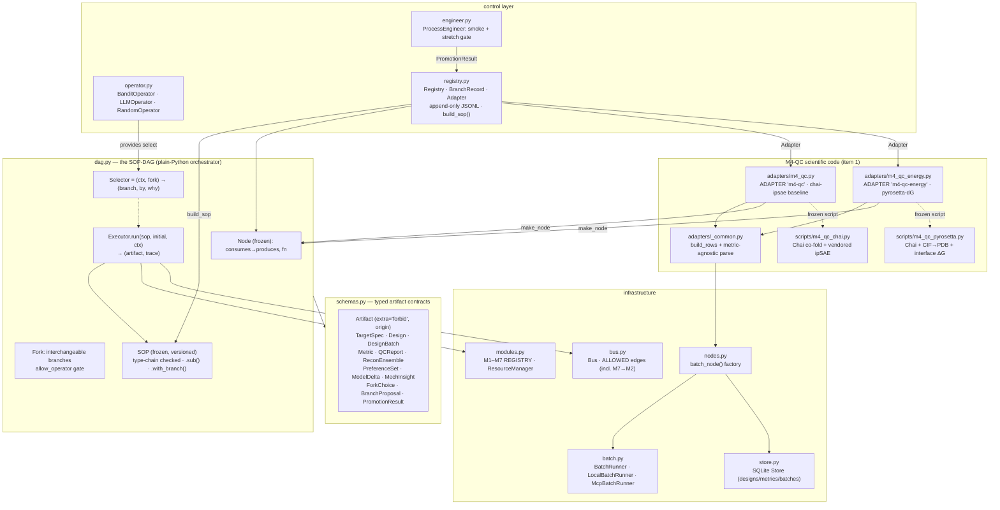
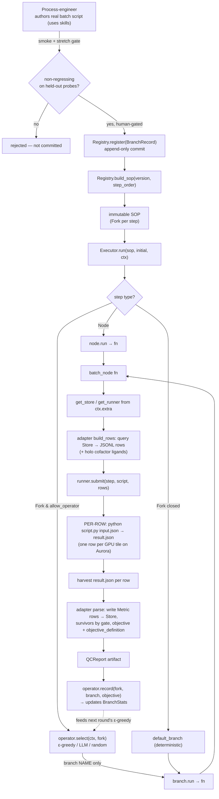
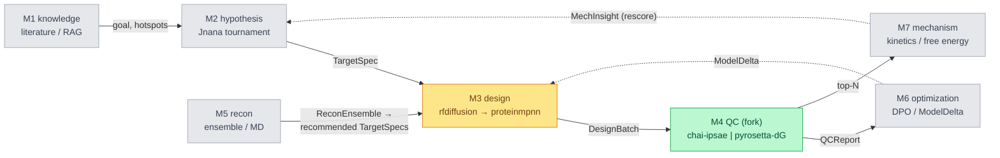

# asop — architecture

Three views of the `asop` control layer (the SOP-DAG that sits on top of
`loamlite`): the **module/dependency layout**, the **runtime execution flow**,
and the **typed-artifact pipeline** (M1→M7 target state).

GitHub renders the Mermaid blocks below inline. To edit, paste a block into
<https://mermaid.live>.

---

## 1. Module layout & dependencies

---

## 2. Runtime execution flow (one SOP round)

---

## 3. Typed-artifact pipeline (M1→M7 target state)

Green = built (M4 fork + both branches) · amber = partially scaffolded
(M3 adapter is next) · grey = infra-ready, scientific body not yet written.
Matches `TODO.md`.

---

## Reading notes

- **The operator's only influence on control flow is the branch _name_**
  (view 2, `OPsel → branch NAME only`). Everything else is deterministic Python
  — the closed-choice contract.
- **The registry is the single trust boundary**: a script only enters the
  running SOP through `register()`, gated by the stretch test and a type-check of
  the adapter's I/O.
- **`_common.py` is the shared seam** both QC adapters sit on, so a third QC
  branch needs no new glue.
